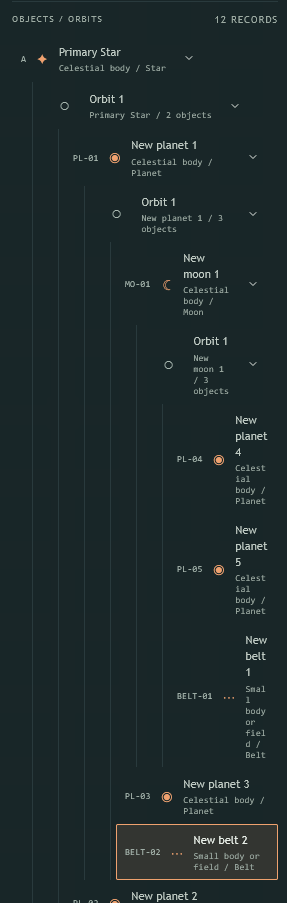

# 05: Keep deeply nested Hierarchy rows readable

## Source and observed problem

Reported directly by the user on 2026-10-30 after adopting `UTree`. Deeply nested Objects / Orbits become difficult to scan: indentation and guide rails, keys, symbols and chevrons consume nearly all row width. Names and secondary metadata then wrap almost character by character, producing excessively tall rows.

The supplied screenshot shows this on an alternating object/Orbit branch containing Primary Star, New planet 1, New moon 1 and further descendants. The screenshot crop is 286px wide; the original viewport and panel settings were not supplied.

Planning baseline: `8fea36283b9eac0ef1cfa49fd7f8f5f4479e13d5` on `codex/global-search`. This is a presentation follow-up to the completed [global-search effort](../spec.md).

## Blocked by

None. Independent of [Show type icons in Search results](04-search-result-type-icons.md).

## Acceptance criteria

- [ ] At the normal and minimum supported Hierarchy panel widths, a branch at least as deep as the supplied example remains quickly scannable. Budget indentation and row columns so deeper levels retain usable label space.
- [ ] Prioritize object names and Location keys, with recognizable symbols and compact secondary metadata. Prevent ordinary names/type labels from degenerating into one-character columns; keep typography readable.
- [ ] Preserve understandable object/Orbit parent-child relationships and the actual accessible tree levels. Every record remains reachable, including deeper descendants and empty Orbits.
- [ ] Any truncation or reduced secondary presentation provides access to the complete information with keyboard and touch as well as pointer input.
- [ ] Expansion controls, selection/highlight and focus remain clear and usable. Preserve guarded selection, dirty drafts, chevron-to-arrow navigation and externally selected ancestor revelation.
- [ ] The layout works on desktop narrow panels and compact fullscreen Hierarchy, without requiring the user to widen the panel or manually collapse ancestors to read a normal row.

## Implementation pointers

Start with [MapHierarchy.vue](../../../components/MapHierarchy.vue), the installed `UTree` slots/UI settings and existing panel sizing. Reconsider cumulative indentation, the row's fixed/shrinking columns and secondary metadata placement together. Retain `UTree` and the existing hierarchy projection/commands; choose the exact row composition during implementation.

## Verification

Reproduce the screenshot's alternating deep branch through public workspace/import helpers. Inspect before/after captures at normal/minimum panel widths and compact layout, with representative long names, keys and secondary labels. Add a focused rendered-layout regression for the deep rows and rerun affected Tree selection/expansion/focus journeys. Run applicable lint/typecheck and UI checks. A shallow two-level tree does not establish this fix.

## Implementation checkpoint

Implementation authorized on 2026-11-02 on the existing `codex/global-search` branch. Re-fetched `origin`: HEAD remains `8fea36283b9eac0ef1cfa49fd7f8f5f4479e13d5`, and `origin/main` remains `d40e5f515baf1afeb0e2135461287b243b2a1f6c` (0 behind / 20 ahead). The intentionally different feature baseline contains tickets 01–03. Local `main` is checked out in another worktree and is left untouched.

The Hierarchy specialist owns `MapHierarchy.vue` and the focused deep-layout test/fixture. Ticket 04 runs in parallel with disjoint file ownership. The coordinator owns Git, runtime resources, integrated checks and review.
