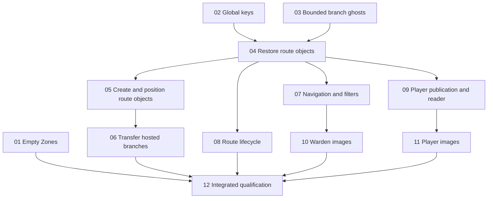

# Zone and route-object implementation ticket plan

The user approved these 12 tickets and their blocking edges on 2026-11-26, after clarifying that route objects include stationary obstacles as well as moving ships. Each ticket is published as a separate local implementation brief. The accepted scope is [Zones and catalogue objects on routes](spec.md).

The source intake remains [Place and manage inter-system objects, including ships on Jump Routes](https://github.com/Submoon/ttrpg-cluster-control/issues/60). Publishing this plan does not modify or close that GitHub issue.

## Baseline

Fetched origin/main, local main and codex/issue-60-framing were verified at c649b576f1636c8ffec57da6b6112b6316bee882 on 2026-11-26. No different implementation base is intended. Tickets carry this original baseline; an implementer integrates completed predecessors and records the actual candidate before work. Preserve local planning and environment files.

## Scope and slicing

A route object can be stationary or moving; all catalogue types are eligible. Relative route position is manual and implies neither speed nor automatic travel.

Each slice has a complete observable workflow with relevant validation and persistence. Restoring a campaign with route objects provides a real read/edit/save path before direct creation and cross-context dragging. There is no schema-only or UI-only ticket.

No broad internal-symbol rename is required as an upfront prefactor for Zone terminology. Introduce compatible context and proposal interfaces within the slices that first use them. Shared codec/controller changes need coordination even where the graph permits independent work; unblocked tickets do not mandate concurrent writers.

Intermediate consumers must retain admitted source data and privacy or explicitly reject an unsupported operation. Never orphan branches or silently emit incomplete source backups. The final ticket qualifies integrated capabilities rather than absorbing unfinished predecessor functionality.

## Ticket index

| Ticket | Blocked by | Specification stories |
| --- | --- | --- |
| 01. [Create empty generic Zones](tickets/01-empty-generic-zones.md) | None | 1-6 |
| 02. [Assign Cluster-wide Location keys](tickets/02-cluster-wide-location-keys.md) | None | 16-19, 68, 72 |
| 03. [Bound Zone placement with full-branch ghosts](tickets/03-bounded-zone-branch-ghosts.md) | None | 20-29, 31-33, 42-45, 56 |
| 04. [Restore and preserve route objects](tickets/04-restore-route-objects.md) | [Assign Cluster-wide Location keys](tickets/02-cluster-wide-location-keys.md); [Bound Zone placement with full-branch ghosts](tickets/03-bounded-zone-branch-ghosts.md) | 10-11, 13, 15, 17, 19-20, 41, 53, 65-67, 71-72 |
| 05. [Create and position catalogue objects on routes](tickets/05-create-position-route-objects.md) | [Restore and preserve route objects](tickets/04-restore-route-objects.md) | 7-9, 17-18, 23-25, 30-32, 34-36, 39-44, 53, 56 |
| 06. [Transfer hosted branches between Zones and routes](tickets/06-transfer-hosted-route-branches.md) | [Create and position catalogue objects on routes](tickets/05-create-position-route-objects.md) | 8-15, 23-32, 40, 42-45, 56, 66 |
| 07. [Find and inspect route objects across semantic zoom](tickets/07-route-object-navigation-and-filters.md) | [Restore and preserve route objects](tickets/04-restore-route-objects.md) | 41, 50-56 |
| 08. [Review route edits and destructive consequences](tickets/08-route-lifecycle-consequences.md) | [Restore and preserve route objects](tickets/04-restore-route-objects.md) | 14-15, 37-39, 41-49 |
| 09. [Publish and read route objects without private-route leaks](tickets/09-publish-and-read-route-objects.md) | [Restore and preserve route objects](tickets/04-restore-route-objects.md) | 54-55, 57-64, 71-72 |
| 10. [Export Warden maps with route objects](tickets/10-warden-route-object-map-exports.md) | [Find and inspect route objects across semantic zoom](tickets/07-route-object-navigation-and-filters.md) | 65, 67-71 |
| 11. [Export player images from permitted route object scenes](tickets/11-player-route-object-image-exports.md) | [Publish and read route objects without private-route leaks](tickets/09-publish-and-read-route-objects.md) | 59-64, 69-72 |
| 12. [Qualify the complete Zone and route-placement workflow](tickets/12-integrated-zone-route-qualification.md) | [Create empty generic Zones](tickets/01-empty-generic-zones.md); [Transfer hosted branches between Zones and routes](tickets/06-transfer-hosted-route-branches.md); [Review route edits and destructive consequences](tickets/08-route-lifecycle-consequences.md); [Export Warden maps with route objects](tickets/10-warden-route-object-map-exports.md); [Export player images from permitted route object scenes](tickets/11-player-route-object-image-exports.md) | 1-72 |

Each ticket starts open and unclaimed with enhancement and ready-for-agent roles. Ready-for-agent describes the brief's completeness; only tickets whose blockers are closed belong to the execution frontier.

## Dependency graph

## Initial execution frontier

- [Create empty generic Zones](tickets/01-empty-generic-zones.md).
- [Assign Cluster-wide Location keys](tickets/02-cluster-wide-location-keys.md).
- [Bound Zone placement with full-branch ghosts](tickets/03-bounded-zone-branch-ghosts.md).

Claim an available ticket before implementation. Preserve ticket paths and record its outcome and evidence in that ticket; do not treat the initial frontier above as an automatically synchronized status report.

## Verification policy

The user explicitly required limited browser journeys. Most coverage belongs in existing domain, geometry, codec/projection and real controller/history seams. A ticket does not imply a new browser journey. Extend the owning maintained journey with the smallest useful assertion; a new case needs a distinct important failure that cheaper tests and existing journeys cannot observe.

Use temporary artifacts for incidental visual inspection, retain first-failure evidence, and bind results to the actual candidate. Reuse valid evidence for unchanged code. Run integrated qualification on the frozen cumulative candidate according to repository guidance.

## Publication record

The approved granularities and edges are the graph above. Detailed acceptance criteria and focused verification obligations live only in the linked ticket briefs. All 72 specification stories are assigned to delivery tickets before the cumulative qualification ticket. Implementation has not started; no merge, release or source closure is authorized by this plan.
