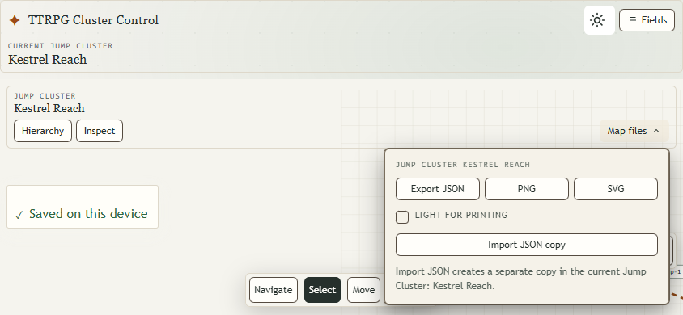
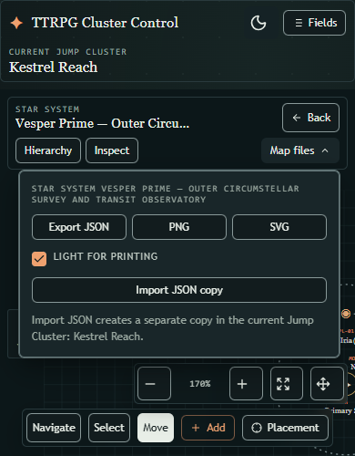

# Ticket 28 verification — 2026-10-22

Baseline: `8d98fa04c17e5b5444ae5f8c965029e0c89dd599`, fetched feature branch; origin/main `629d2a98715c3a16b954e0f77c639b1f0c31212c` has no unique commits. Source issue 3 is unchanged/open; PR 28 remains draft. Real persisted editor, approved B/Dock composition, maximum Nuxt UI reuse. No prototype or successor cleanup is performed.

## Candidate and checks

- [Initial reviewed source](review-source-manifest.json); [final application source](final-source-manifest.json) differs only by the reviewed one-shot print-option reset.
- [Compiled application files](compiled-manifest.json): 99 generated JS/CSS/JSON files outside dependency packages; manifest SHA256 `1E6E3F6B0FD186B29179C3DD2155FEB6E79B5D7975DE25AB630BF5EE99FC9B3A`.
- Typecheck passes. Single final production build passes in 2m48s.
- Seven new palette/draft cases and two affected existing image/interchange journeys pass in focused warm-development runs. Both maps × active-light/active-dark/print-from-dark × SVG/PNG; real PNG background pixel, SVG/PNG source/dimensions, long title, clean complete scene, unresolved cues and retained live camera/theme/applied JSON/draft.
- Ordinary control hit testing and focus at 844×390 light and 390×500 dark. Root inspected both captures: anchored Map files, compact header, bottom Dock and overlay composition are retained. The added control is Nuxt UI `UCheckbox`.

## Final outcomes

- [Complete-suite summary](full-suite-summary.json): **185 passed / 5 failed**, 33.9 minutes, one worker, zero retries/skips/flaky outcomes. Production application plus the one existing development-storage case, which passes.
- The five failures are resolved through focused test corrections on **unchanged eight-file application and 99-file compiled hashes**. The first corrected rerun passes 4/5 (1.8 minutes); the remaining preview case passes its final single-case run (20.3 seconds, 31.3 seconds total). [Targeted attempt summaries](targeted-results-summary.json) retain the intermediate failures too. **No fresh 190/190 complete run is claimed.**
- All ten new export cases pass across those runs: applied full scenes and title, three palettes/two formats on both maps, hidden draft, local resize, parent object and Orbit host/geometry/carry previews, held Cluster drag/routes/unresolved exits, failed saving and separate PNG failure. Every preview compares its viewBox with an applied baseline. The parent-Orbit PNG pair has identical decoded RGBA SHA256 and dimensions, with exact applied source geometry; the live preview remains intact.
- [Accepted tests](accepted-test-manifest.json), SHA256 `0D03617818893ADB2D33038E7C32ED66BC80D06E2290BC93F2913F7F8DFF8984`. Earlier test manifests identify the full-suite and initial corrected-five candidates separately.
- Both screenshots above now come from the compiled production candidate. Their ordinary focus/hit checks pass. Source and compiled manifests are unchanged after runtime verification.

## Review and intermediate outcomes

SOL 6.1 High contract and independent technical/Standards and specification/image-interchange reviews; Luna XHIGH implementation and tests. No application defect is reported by either initial source review. The final checkbox reset is independently verified.

Initial tracer RED is the absent print option on the prior compiled application. Its first GREEN and subsequent warm-development runs are retained under host TEMP `ticket23-ticket28-*`. Interrupted matrix attempts and failed pilots expose test setup errors (SVG group click reachability, retained overlays/mode, uppercase accessible name, remapped import identities, obsolete title/geometry expectations). Those errors are corrected without forcing clicks, adding retries, broadening global timeouts or modifying application source. Reference text bounds allow at most one map unit of font rounding; full image containment and exact SVG/PNG agreement remain required. See [execution chronology](../../../research/implementation-28-2026-10-22.md) for exact checkpoints.

Final correction review preserves live background, negative-X, off-viewport, and reload assertions while replacing only an obsolete exported negative-Y margin assumption with actual feature/title containment. Two historical multi-operation journeys receive scoped 60-second budgets; the global timeout and retry policy stay unchanged. Tests explicitly open Inspect and use the actual hierarchy name. Opening Map files closes another popover, so the preview test reopens Placement and verifies retained confirmation and geometry. Only the added parent-Orbit probe's redundant live-font bounding-box comparison becomes strict exported-content containment; matrix reference checks, exact scene geometry, exact baseline viewBox and decoded pixels remain. Preview readiness uses the inspector's actual status role. Independent correction review reports no remaining blockers.

No physical Android Chrome OS-keyboard, safe-area or two-finger validation is performed. Browser checks use isolated Chrome contexts and existing approved public controls/downloads/geometry and storage failure seams. Simulated compact viewports are not physical-device evidence. Ticket 29 retains final whole-product cleanup/performance and Astra/Tools review.
