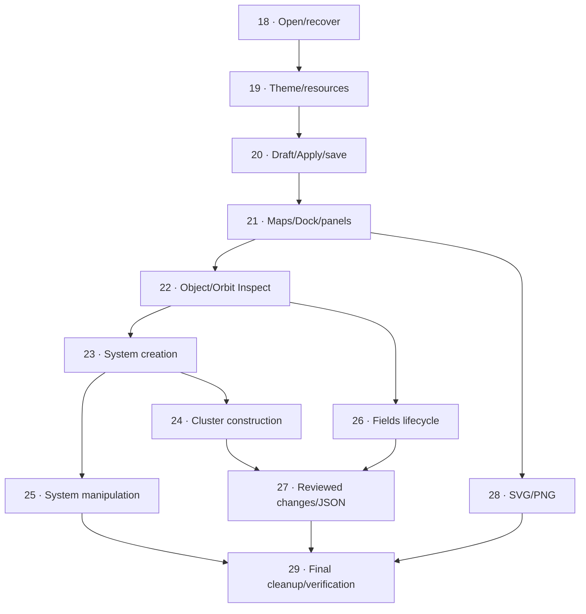

## Authority and approved scope

Implement the [complete specification](spec.md), retaining the [closed decision map](map.md) as rationale. The human explicitly approves **twelve local tickets and their dependencies** on 2026-10-16 after requesting fewer than the first twenty-slice proposal. The [decomposition review](research/ticket-decomposition-review-2026-10-16.md) records both candidate identities, independent reviews and approval. The human separately requires the last ticket to clean up all effort documentation, disconnect prototypes and perform other necessary cleanup.

Source [Revamp the interface](https://github.com/Submoon/ttrpg-cluster-control/issues/3) remains open and unchanged, with no issue comments/labels/closure included in this planning step. Freshly fetched intake is `codex/interface-revamp` at `f4aa1b4438217412c308e61733d862f3d71597ca`, equal to its remote, 0 main-only / 23 feature-only against `origin/main = 629d2a98715c3a16b954e0f77c639b1f0c31212c`. The specification SHA-256 remains `DF58B9D8715140A8F18D9F808FF83A2B1EBEC3F2596A2B23F37F1E51778E212F`. These are recorded intake identities, not a demand to reset later work.

## Approved delivery graph

| Local ticket | What it delivers | Direct blockers |
| --- | --- | --- |
| [Open and recover the real local workspace at the product root](tickets/18-open-and-recover-local-workspace.md) | Real creation, resume and validated recovery at the product root. | None |
| [Choose a coherent local light or dark presentation](tickets/19-theme-and-local-resources.md) | Durable OS-first/explicit theme behavior, common palettes and local icons. | 18 |
| [Rename charts with resumable drafts and trustworthy Apply/save recovery](tickets/20-resumable-chart-drafts-and-save-recovery.md) | A real chart-editing journey establishes session ownership, guarded transitions and memory-versus-save recovery. | 19 |
| [Explore separate maps through the responsive Dock, Hierarchy and Inspect](tickets/21-responsive-map-navigation-and-panels.md) | Context/Back, navigation, readable Dock, independent desktop and exclusive compact panels. | 20 |
| [Edit complete object and Orbit data through a resumable Inspector](tickets/22-complete-object-and-orbit-inspectors.md) | Full object/Orbit fields, geometry, validation and targeted draft exclusion. | 21 |
| [Populate star systems with every catalogue type and Orbit structure](tickets/23-system-object-and-orbit-creation.md) | Actual anchored persistent Add, deliberate system-map targeting and complete catalogue/Orbit creation. | 22 |
| [Construct and arrange a Jump Cluster with complete Jump Routes](tickets/24-cluster-systems-and-jump-routes.md) | Repeated Add System, cluster movement, route creation/editing and cluster input arbitration. | 23 |
| [Reposition objects and manipulate Orbit geometry safely](tickets/25-safe-system-object-and-orbit-manipulation.md) | Object attachment/movement, Orbit controls and system input arbitration. | 23 |
| [Consult, edit and create Fields without losing work or assignments](tickets/26-resumable-fields-lifecycle.md) | Complete resumable Fields consultation/edit/create and accurate affected-value reviews. | 22 |
| [Review destructive changes and exchange independent JSON copies safely](tickets/27-reviewed-deletion-and-json-interchange.md) | Accurate cascade/import review, independent copies, complete current JSON and stale-ID cleanup. | 24, 26 |
| [Export clean complete SVG and PNG in active or print light palettes](tickets/28-clean-themed-svg-png-exports.md) | Applied full-scene output, clean bounds, matching formats and unchanged live state. | 21 |
| [Finish the production editor and retire the revamp experiments](tickets/29-final-cleanup-and-product-validation.md) | Consolidated documentation, retired experiments/unused code and final post-cleanup verification/performance. | 25, 27, 28 |

## Work the available frontier

Initial frontier is **ticket 18 only**. It is `open` and unclaimed; the other eleven start `blocked` and unclaimed because their direct prerequisites are unmet. `ready-for-agent` is a separate triage role meaning specified, not permission to bypass blockers. Read current ticket frontmatter and blocker states rather than treating this initial snapshot as a permanent queue.

After 21, image export 28 can proceed independently of Fields, deletion and import. After 22, system creation 23 and Fields 26 can proceed by available ownership/capacity. After 23, cluster construction 24 and system manipulation 25 can proceed independently. Parallel graph availability does not authorize overlapping writes in the shared checkout; the coordinator applies actual file ownership and project concurrency limits.

Ticket 29 must remain last: its three direct blockers transitively include every ticket 18–28. Start it only after every preceding implementation ticket is closed. The final cleanup classifies all documentation as canonical/archive/remove, preserves useful decision/evidence provenance and user data, audits usage before removal, keeps necessary valid fixtures tests-only, and measures the compiled product after comparison/sample removal. It is not a deferred implementation catch-all.

## Execution and evidence

Coordinate and analyze with **SOL 6.1 High**; delegate implementation to **Luna XHIGH** as requested. Follow the repository's project-development routing for contract design, bounded ownership, risk-appropriate independent reviews, correction and validation. Every ticket is self-contained with its approved scope, acceptance checklist, specification stories, B1–B10 families and blockers. No implementation has started from creating this backlog.

Use maximum Nuxt UI reuse, authoritative existing domain/identity/schema, presentation-independent drafts, targeted exclusion and separate validated-memory/durable-save boundaries. Preserve working baseline commands during rollout; do not promote the disposable sample or expose placeholder success. Every relevant workflow owns its accessibility, both-theme, automated mobile and failure-path evidence rather than deferring those to the final ticket. Android targets **Chrome only**, with targeted OS-keyboard/physical-gesture checks supplementing Playwright emulation. The [test-seam report](research/spec-test-seams-2026-10-16.md) provides actual prior art and limits.

The initial planning publication did not implement the product or claim test/build/device passes, source issue closure or merge. Close local tickets only after their own criteria and evidence are satisfied; closing all local tickets does not automatically close the source request.

## Implementation progress

2026-10-16 — Tickets 18 (`006a2451`) and 19 (`e014a549`) are closed and pushed. Ticket 20 is closed after its repaired chart/guard/save source, typecheck, 25 compiled portable cases, eight-case compiled presentation matrix and independent technical/domain-data reviews pass; its publication checkpoint is being recorded. Ticket 21 starts only after that commit/push, under the human's explicit sequential instruction. The [execution record](research/implementation-18-21-2026-10-16.md) holds exact checkpoint identities, evidence and limits. Other tickets remain blocked by the approved graph. No source-issue completion or physical-device pass is inferred.
