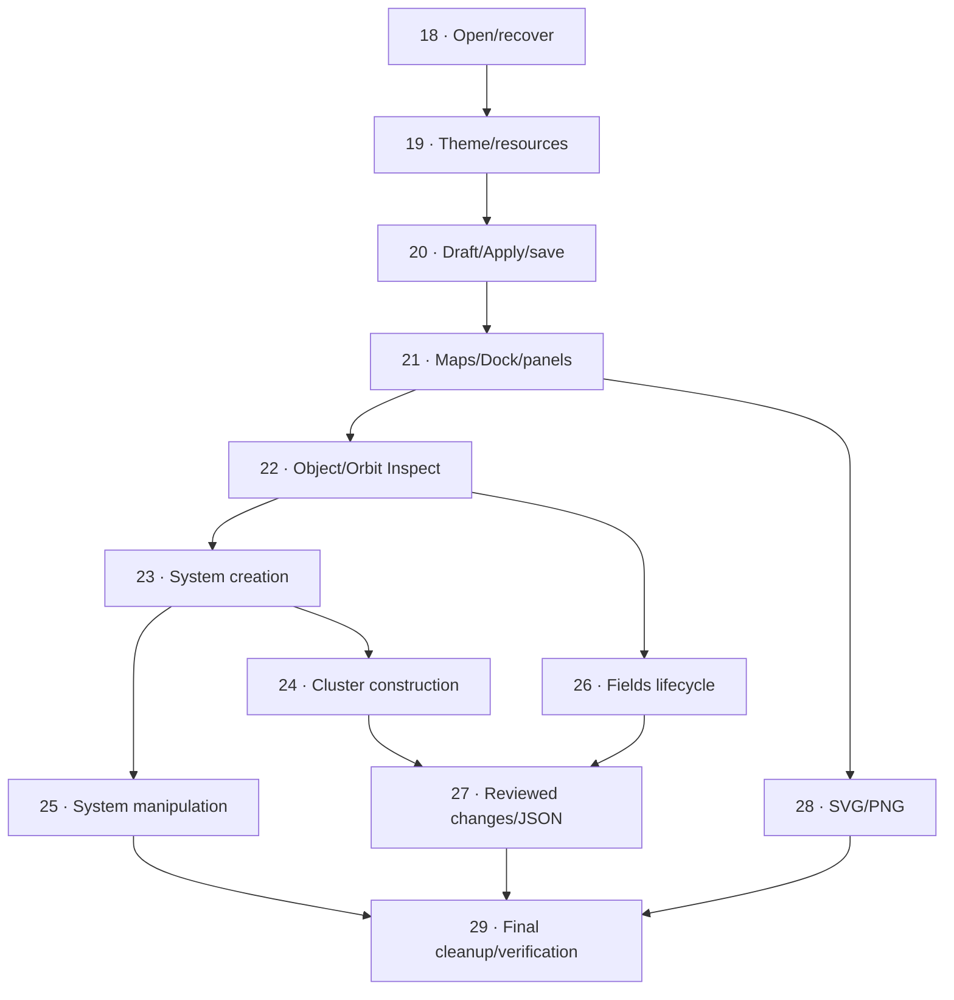

## Authority and approved scope

Implement the [complete specification](spec.md), retaining the [closed decision map](map.md) as rationale. The human explicitly approves **twelve local tickets and their dependencies** on 2026-10-16 after requesting fewer than the first twenty-slice proposal. The [decomposition review](research/ticket-decomposition-review-2026-10-16.md) records both candidate identities, independent reviews and approval. The human separately requires the last ticket to clean up all effort documentation, disconnect prototypes and perform other necessary cleanup.

That approval covers the breakdown and dependencies, not permission to replace the accepted B/Dock composition. After inspecting the integrated product, the human rejects the structural drift and withdraws acceptance of the 18–21 delivery batch. The [presentation acceptance reset](research/interface-fidelity-reset-2026-10-16.md) and corrected specification govern the reassessment. Nuxt UI may change component details; bottom Dock, map priority, overlay panels and compact header remain required.

Corrected specification SHA-256: `EE5A92BC565933541233F06BC0607F5F6384F0A925A53677985A9F97A32FB1A0`. The earlier hash below identifies the original planning snapshot, whose presentation wording proved insufficient; it is not the current acceptance reference.

Source [Revamp the interface](https://github.com/Submoon/ttrpg-cluster-control/issues/3) remains open and unchanged, with no issue comments/labels/closure included in this planning step. Freshly fetched intake is `codex/interface-revamp` at `f4aa1b4438217412c308e61733d862f3d71597ca`, equal to its remote, 0 main-only / 23 feature-only against `origin/main = 629d2a98715c3a16b954e0f77c639b1f0c31212c`. The specification SHA-256 remains `DF58B9D8715140A8F18D9F808FF83A2B1EBEC3F2596A2B23F37F1E51778E212F`. These are recorded intake identities, not a demand to reset later work.

## Current frontier - 2026-10-21

**18–24 are closed;25,26,28 are open/unclaimed;27 remains blocked by26;29 remains blocked by25,27,28.** Ticket24 delivers targeted repeated system creation, precise system movement and complete resumable Jump Route editing with Nuxt UI, retaining the accepted B/Dock structure. Final complete validation is **135/135**, zero failures/skips/flaky cases/retries, on113 unchanged inputs. Typecheck/build, independent bounded technical/domain reviews and24/24 presentation checks pass their stated scopes. Physical Android Chrome/OS-keyboard/safe-area checks remain unavailable. See the [ticket24 execution record](research/implementation-24-2026-10-20.md) and [final QA report](implementation-lab/ticket-24-2026-10-21/qa/README.md). No successor is started; issue3 remains open, PR28 draft and the final whole-interface Astra review, including Tools coherence, stays in29.

### Prior ticket23 checkpoint

**18–23 are closed;24,25,26 and28 are open and unclaimed;27 and29 are blocked and unclaimed.** The [direct-Add follow-up](research/implementation-23-direct-add-2026-10-20.md) removes mandatory creation confirmation and passes the final complete suite **124/124**, zero retries/skips/flaky cases, on the unchanged compiled candidate (123 compiled plus one established development-only storage proof). Typecheck/build, both independent review lenses and bounded desktop/mobile presentation pass. The first parallel full run117/7 and same-source serial diagnostic7/7 remain separate evidence; serial execution preserves all original deadlines. Prior111/8/119 results remain historical. No successor is started; issue3 remains open, PR28 draft and the final whole-interface Astra review, including Tools coherence, stays in29.

### Earlier ticket21 checkpoint

Final typecheck/build pass. The sole compiled109-case run gives104 passed/5 failed; all five failed titles have attributed passing retests (four compiled, one unchanged development-only storage-module proof). Eight paired product/B presentation PNGs and bounded compact keyboard/hit/contrast checks support scoped fidelity, with disclosed fixture and durable-status differences. This is not a single-run109/109 or physical Android Chrome certificate. Issue3 remains open, PR28 remains draft and the final whole-interface Astra review, including Tools coherence, remains in29.

## Approved delivery graph

| Local ticket | What it delivers | Direct blockers |
| --- | --- | --- |
| [Open and recover the real local workspace at the product root](tickets/18-open-and-recover-local-workspace.md) | Real creation, resume and validated recovery at the product root. | None |
| [Choose a coherent local light or dark presentation](tickets/19-theme-and-local-resources.md) | Durable OS-first/explicit theme behavior, common palettes and local icons. | 18 |
| [Rename charts with resumable drafts and trustworthy Apply/save recovery](tickets/20-resumable-chart-drafts-and-save-recovery.md) | A real chart-editing journey establishes session ownership, guarded transitions and memory-versus-save recovery. | 19 |
| [Explore separate maps through the responsive Dock, Hierarchy and Inspect](tickets/21-responsive-map-navigation-and-panels.md) | Context/Back, navigation, readable Dock, independent desktop and exclusive compact panels. | 20 |
| [Edit complete object and Orbit data through a resumable Inspector](tickets/22-complete-object-and-orbit-inspectors.md) | Full object/Orbit fields, geometry, validation and targeted draft exclusion. | 21 |
| [Populate star systems with every catalogue type and Orbit structure](tickets/23-system-object-and-orbit-creation.md) | Actual anchored persistent Add, deliberate system-map targeting and complete catalogue/Orbit creation. | 22 |
| [Construct and arrange a Jump Cluster with complete Jump Routes](tickets/24-cluster-systems-and-jump-routes.md) | Repeated Add System, cluster movement, route creation/editing and cluster input arbitration. | 23 |
| [Reposition objects and manipulate Orbit geometry safely](tickets/25-safe-system-object-and-orbit-manipulation.md) | Object attachment/movement, Orbit controls and system input arbitration. | 23 |
| [Consult, edit and create Fields without losing work or assignments](tickets/26-resumable-fields-lifecycle.md) | Complete resumable Fields consultation/edit/create and accurate affected-value reviews. | 22 |
| [Review destructive changes and exchange independent JSON copies safely](tickets/27-reviewed-deletion-and-json-interchange.md) | Accurate cascade/import review, independent copies, complete current JSON and stale-ID cleanup. | 24, 26 |
| [Export clean complete SVG and PNG in active or print light palettes](tickets/28-clean-themed-svg-png-exports.md) | Applied full-scene output, clean bounds, matching formats and unchanged live state. | 21 |
| [Finish the production editor and retire the revamp experiments](tickets/29-final-cleanup-and-product-validation.md) | Consolidated documentation, retired experiments/unused code and final post-cleanup verification/performance. | 25, 27, 28 |

## Work the available frontier

Initial frontier is **ticket 18 only**. It is `open` and unclaimed; the other eleven start `blocked` and unclaimed because their direct prerequisites are unmet. `ready-for-agent` is a separate triage role meaning specified, not permission to bypass blockers. Read current ticket frontmatter and blocker states rather than treating this initial snapshot as a permanent queue.

After 21, image export 28 can proceed independently of Fields, deletion and import. After 22, system creation 23 and Fields 26 can proceed by available ownership/capacity. After 23, cluster construction 24 and system manipulation 25 can proceed independently. Parallel graph availability does not authorize overlapping writes in the shared checkout; the coordinator applies actual file ownership and project concurrency limits.

Ticket 29 must remain last: its three direct blockers transitively include every ticket 18–28. Start it only after every preceding implementation ticket is closed. The final cleanup classifies all documentation as canonical/archive/remove, preserves useful decision/evidence provenance and user data, audits usage before removal, keeps necessary valid fixtures tests-only, and measures the compiled product after comparison/sample removal. It is not a deferred implementation catch-all.

The human-requested final Astra review covers the whole implemented interface, including Tools semantics/grouping and the conceptual comparison with Foundry VTT. Ticket 29 explicitly retains this gate; an earlier prototype review is not final product certification.

## Ticket 21 resumed verification - 2026-10-19

The human authorizes ticket21 only after ticket20 is finished and pushed. That condition is fulfilled at `e8bb78c014909f9046eb43c405cfbd7a72b43e3f`, equal to the feature remote at intake. Ticket21 now completes its scoped B/Dock reassessment with Nuxt UI; [its execution record](research/implementation-21-resume-2026-10-19.md) separates implementation, source reviews, failed full-suite results, attributed focused corrections and actual paired visual checks. The sole complete 99-case invocation gives74 passed/25 failed; its failed cases have successful focused retests, not a single-run99/99 certificate. Final typecheck/build, the six-blocker retests and bounded cue/resize checks pass. Physical Android Chrome checks remain unavailable.

**Current frontier:18–21 are closed;22 and28 are open and unclaimed;23–27 and29 remain blocked and unclaimed.** No later implementation is started. The whole-interface Astra review, including Tools coherence, stays in final ticket29. Source issue3 remains open and PR28 remains draft. Historical progress entries below describe earlier checkpoints and do not replace this frontier.

## Execution and evidence

### Ticket22 explicit implementation - 2026-10-19

The human authorizes implement for ticket22 using Luna XHIGH implementation, prototype fidelity and Nuxt UI. It is claimed/in-progress from `2a4564d7ef5916df0cc4e025e7997ca7c86f81f7`, equal to the fetched feature remote (0 main-only/43 feature-only against unchanged main). The [execution record](research/implementation-22-2026-10-19.md) and [contract](research/ticket-22-contract-2026-10-19.md) govern the scoped resumable object/Orbit Inspector work. SOL6.1 High defines/reviews; two disjoint Luna writers implement; QA owns runtime. Object and Orbit tracer journeys pass after recorded corrections, but remaining guards, preservation, visual checks and independent reviews are not complete. **18–21 remain closed;22 is in-progress;28 remains open/unclaimed;23–27 and29 remain blocked.** No successor is started; source issue3 remains open and PR28 draft.

Coordinate and analyze with **SOL 6.1 High**; delegate implementation to **Luna XHIGH** as requested. Follow the repository's project-development routing for contract design, bounded ownership, risk-appropriate independent reviews, correction and validation. Every ticket is self-contained with its approved scope, acceptance checklist, specification stories, B1–B10 families and blockers. No implementation has started from creating this backlog.

Use maximum Nuxt UI reuse, authoritative existing domain/identity/schema, presentation-independent drafts, targeted exclusion and separate validated-memory/durable-save boundaries. Preserve working baseline commands during rollout; do not promote the disposable sample or expose placeholder success. Every relevant workflow owns its accessibility, both-theme, automated mobile and failure-path evidence rather than deferring those to the final ticket. Android targets **Chrome only**, with targeted OS-keyboard/physical-gesture checks supplementing Playwright emulation. The [test-seam report](research/spec-test-seams-2026-10-16.md) provides actual prior art and limits.

The initial planning publication did not implement the product or claim test/build/device passes, source issue closure or merge. Close local tickets only after their own criteria and evidence are satisfied; closing all local tickets does not automatically close the source request.

## Implementation progress

Historical technical checkpoints 18 (`006a2451`), 19 (`e014a549`), 20 (`338cc138`) and the partial 21 product (`b37c1abd`) were pushed. Their scoped technical results remain evidence, but the human rejects the integrated visual result. Earlier closure statements for 18–20 are superseded; none of the four is currently accepted as a completed delivery batch.

Current frontier: **18 is open and unclaimed for reassessment; 19–21 are blocked and unclaimed by their existing dependency chain. Tickets 22–29 remain blocked and unclaimed.** Reassess what can be retained before changing code; do not assume the functional foundations must be rewritten. The [execution record](research/implementation-18-21-2026-10-16.md) preserves actual passes, failures and source identities. The 405/405 presentation observations do not establish prototype fidelity; the full 93-test suite was interrupted and never passed. Two focused preservation failures remain unclassified.

The human explicitly requests documentation/criteria correction, then a stop. **Implementation and testing are stopped until an explicit request to resume.** The next implementation must follow the corrected visual contract and paired comparison gate before claiming closure. No source-issue completion, merge, complete test-suite success or physical-device pass is inferred.

## Scoped resumption - 2026-10-19

The human explicitly resumes **ticket 18 only**, using implement and requiring the corrected instructions and applicable prototype fidelity. Ticket 18 is claimed/in-progress; tickets 19–29 are not started by this resumption. The previous stop remains in force outside the requested scope. Reuse the existing launch/storage foundation and correct the launch presentation through the [bounded contract](research/ticket-18-resume-contract-2026-10-19.md). The prototype has no empty/loading/recovery flow; compare its applicable visual language without claiming that the rejected loaded-map composition is repaired. See the [resumption execution record](research/implementation-18-resume-2026-10-19.md) for current evidence and preserved local work.

Completed scoped reassessment: **18 is closed; 19 is open and unclaimed; 20–29 remain blocked and unclaimed.** Source candidate `06997ef7` corrects Welcome/loading/recovery with Nuxt UI and compact reachable actions. Development9/9, typecheck, corrected build, portable compiled8/8 and bounded both-theme/four-viewport presentation checks pass; independent source reviews have no remaining findings. One full-suite attempt stops at a cluster-return failure (0 passed, 1 failed, 92 not run), with exact cause unclassified and six pre-existing local test edits preserved outside these commits. No whole-editor acceptance follows. The map Dock/overlay/header correction remains ticket 21; physical Android Chrome checks remain unavailable. Do not continue to ticket 19 without a further request.

## Ticket 19 explicit resumption - 2026-10-19

The human subsequently requests implement for **ticket 19 only**. It is claimed/in-progress; 18 remains closed and 20–29 remain blocked/unclaimed. Fresh feature baseline `f64d00dbaf9cee569a8a62db0005b4ffe7f00ca7` equals the remote (0 main-only / 36 feature-only against unchanged origin/main). Retain useful existing theme/icon code and correct only demonstrated gaps under the [bounded theme/resource contract](research/ticket-19-resume-contract-2026-10-19.md). See the [current execution record](research/implementation-19-resume-2026-10-19.md). This does not resume the map composition or later feature tickets.

Scoped reassessment completed: **18–19 are closed; 20 is open/unclaimed; 21–29 remain blocked/unclaimed.** Source `aeeae7a6` restores the accessible Nuxt UI Theme seam and existing focus style, preserving the palette/preference/icon foundation. Development4/4 (stdout), typecheck, final build, independent compiled4/4, cold browser/server glyph proof and attributed desktop/mobile supplements pass their scoped gates; both source-review axes have no findings. The whole suite remains unsuccessful at the unclassified cluster-return failure (0/1/92). Native-dialog strict BODY-boundary containment, physical Android Chrome and whole-editor B/Dock fidelity are not certified. All attempt provenance and limitations stay in the execution/QA records. Ticket 20 is not started by completing 19.

## Ticket 20 explicit resumption and completion - 2026-10-19

The human resumes ticket 20 from `92c4bd85a2891bb1144c01e19d2b6088a93d5a7b`, equal to the fetched feature branch (0 main-only / 38 feature-only). Scoped source `65f6cc2c` retains the chart/save foundation and corrects compact feedback, truthful session/status cues, recovery popovers and measured explicit Fit. Two confirmed UI defects are causally repaired: short-screen target occlusion and adjacent focus-ring contrast. Source reviews have no blockers; typecheck, attributed compiled28/28 and final CSS-only3/3 plus compact27/27 and details37/37 pass. All failed attempts and the unrecoverable one-shot full-suite result remain explicit; no whole-suite/clean-checkout/physical-device/whole-interface acceptance follows. See the [execution record](research/implementation-20-resume-2026-10-19.md).

Frontier: **18-20 are closed; 21 is open/unclaimed; 22-29 remain blocked/unclaimed.** The human authorizes 21 only after 20 is finished and committed/pushed. Keep the accepted B/Dock structure and use Nuxt UI components; do not treat the rejected top Dock/column panels/dense Header as an accepted delivery. No ticket21 implementation is started by completing20.
