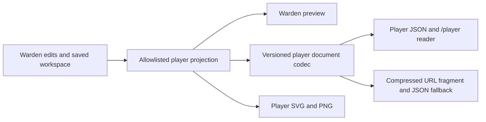

# Player view PR proposal

**Suggested title:** Add secret-safe player views and sharing  
**Base:** `origin/main` — `47c0418a835da285e9edb88e8f8dffc19c3a2bba`  
**Reviewed implementation head:** `codex/player-view-ticket-01` — `6cb95fc1f7b554f965c5f4be1f322bf8fc22d9df` (19 commits ahead; 0 behind)  
**Related to:** [#9 — Player view and secret-free export](https://github.com/Submoon/ttrpg-cluster-control/issues/9)

Prepared locally on 2026-11-04. The parallel timeout diagnosis is recorded in [the local investigation report](timeout-diagnosis.md); its root cause remains undetermined. The PR body below includes that limitation. No push or remote PR creation has occurred.

Local review copies: [specification](spec.md), [ADR 0002](../../docs/adr/0002-player-publication-boundary.md), and [verification record](ticket-06-implementation.md). The proposed body's commit-pinned GitHub links become available when the branch is pushed.

## Summary

Wardens can configure publication for systems, objects, Fields and Jump Routes, preview the public view, and share a sanitized snapshot as player JSON, an immutable compressed link, or SVG/PNG. A standalone `/player` reader keeps player documents separate from the saved Warden workspace.

The player outputs omit GM notes, Location keys, private or unused Field definitions/options, and unrelated hidden branches. Required anonymous Orbit hosts and shared routes retain only the geometry and relationships needed for the published view. Full Warden backup/recovery remains a complete-data path.

The feature spans all seven approved local tickets. Design and behavior are documented in [the specification](https://github.com/Submoon/ttrpg-cluster-control/blob/6cb95fc1f7b554f965c5f4be1f322bf8fc22d9df/.scratch/player-view/spec.md), [ADR 0002](https://github.com/Submoon/ttrpg-cluster-control/blob/6cb95fc1f7b554f965c5f4be1f322bf8fc22d9df/docs/adr/0002-player-publication-boundary.md), [editor architecture](https://github.com/Submoon/ttrpg-cluster-control/blob/6cb95fc1f7b554f965c5f4be1f322bf8fc22d9df/docs/architecture/editor.md), [README](https://github.com/Submoon/ttrpg-cluster-control/blob/6cb95fc1f7b554f965c5f4be1f322bf8fc22d9df/README.md), and the [ticket 06 verification record](https://github.com/Submoon/ttrpg-cluster-control/blob/6cb95fc1f7b554f965c5f4be1f322bf8fc22d9df/.scratch/player-view/ticket-06-implementation.md).

## Evidence

- **Before:** The base branch has complete Warden JSON and rendered-map export workflows, but no separate allowlisted player document, reader, or player export path. Those complete-data artifacts are unsuitable for sharing private workspace content; see [#9](https://github.com/Submoon/ttrpg-cluster-control/issues/9) and [ADR 0002](https://github.com/Submoon/ttrpg-cluster-control/blob/6cb95fc1f7b554f965c5f4be1f322bf8fc22d9df/docs/adr/0002-player-publication-boundary.md).
- **After:** A production build, full-source types, lint, and compiled Chromium checks passed. The compiled probe verified private-data exclusion, SSR/HTTP payload absence, native clipboard sharing, second-tab navigation and reload, and JSON fallback. An actual 8,191-byte complete player URL was exercised; the 8,192-byte application limit is paired with player JSON fallback and is not a guarantee for every messaging service. See the [verification record](https://github.com/Submoon/ttrpg-cluster-control/blob/6cb95fc1f7b554f965c5f4be1f322bf8fc22d9df/.scratch/player-view/ticket-06-implementation.md).
- **Full suite:** The single complete run was **654 passed / 16 failed** out of 670 cases. Focused replays subsequently passed all 16 affected cases (14 in the initial replay; the remaining two in the final 9/9 affected matrix). The eight timing failures passed unchanged on replay. A separate diagnostic run passed all eight three times (24/24), and a bounded replay with original immediate predecessors passed 15/15. Their cause remains undetermined; no application/test logic, deadlines or retry policy was changed for this diagnosis. This is not a clean full-suite pass.
- **CI:** Exact-head CI qualification remains pending publication; the diagnostic successes do not replace the recorded failed complete run.
- **Review:** Standards and Spec reviews closed with zero outstanding findings; the complementary sensitive review also has no outstanding findings.

## Merge Danger

**Door:** One-way for version 4 source data when reopening it with older application builds.

Complete workspaces and new backups move to source format v4. Explicit migrations support legacy v1–v3 inputs with Hidden/private defaults where those older formats lack publication settings; import rejects incompatible Field publication policies rather than silently widening disclosure. New v4 data is not guaranteed to open in older builds, and no downgrade migration is defined. See the versioning and import rules in [ADR 0002](https://github.com/Submoon/ttrpg-cluster-control/blob/6cb95fc1f7b554f965c5f4be1f322bf8fc22d9df/docs/adr/0002-player-publication-boundary.md).

**Blast Radius:** Workspace

This changes the shared workspace schema, persistence, history/recovery, import/export, editor workflows, and adds a separate player route and export surfaces. Player consultation does not hydrate or mutate the Warden workspace. Links are immutable snapshots: anyone holding one can copy its intentionally published content, and an issued link cannot be remotely updated or revoked.
